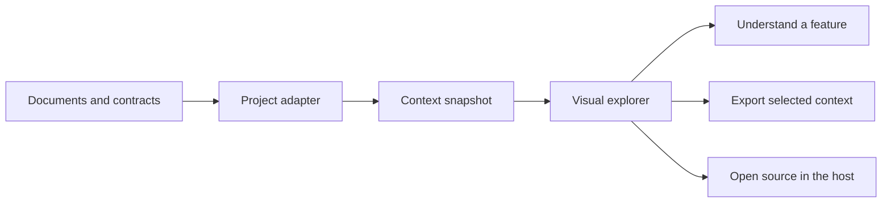

# Context Atlas

Explore a project from the big picture to the exact operation, page, table, or task.
Context Atlas connects written explanations with visual journeys and source evidence,
so people and coding agents can work from the same bounded context.

The first release includes a reusable React explorer, a framework-neutral snapshot
model, an OpenAPI adapter, and a standalone demo with synthetic API and website projects.



## Run locally

Requires Node.js 22.12 or later and npm.

```sh
git clone https://github.com/hi-donwi/Context-Atlas.git
cd Context-Atlas
npm ci
npm run dev
```

Open the local URL printed by Vite. The demo runs in the browser; it does not require
a backend, database, account, or API key.

## Explore

- **Overview:** project purpose, modules, evidence, and available views.
- **Journey:** ordered steps and relationships across actors, operations, and data.
- **Architecture:** the declared parts of the project and how they relate.
- **API:** methods, paths, parameters, payloads, responses, and authentication.
- **Data:** entities, tables, fields, and explicit relationships.
- **Work:** linked tasks, their state, and the feature they support.
- **Study:** explanations, scenarios, and open questions linked to actual project objects.

Each project declares its capabilities. An API project does not need fictional pages,
and a learning project does not need fictional endpoints. Search and module filtering
help narrow the work surface; a written inspector keeps details readable without
putting every field on the canvas.

Implementation status, evidence quality, and source freshness are separate. A proposed
scenario is not an accepted feature, and a source reference is not proof of runtime behavior.

## Bring your own context

Import a **Context Snapshot 1.0 JSON** file or an **OpenAPI 3.0/3.1 JSON** document.
Imports stay in browser memory. The demo does not upload them, fetch remote references,
execute API requests, or discover files on your machine.

The OpenAPI adapter projects declared operations and schemas. It does not infer
database usage, application services, user journeys, or implementation completion.
See [integration guidance](docs/integration.md) for adapting other sources.

Select an object to export its bounded neighborhood as Markdown or snapshot JSON.
Exports include source revisions and evidence labels. Hosts provide an explicit source
allowlist; they must authorize the snapshot and export scope before passing data to
the viewer. The allowlist is a selection mechanism, not an authorization system.

## Packages

| Package | Responsibility |
| --- | --- |
| `@context-atlas/model` | Snapshot types, runtime validation, graph selection, context export |
| `@context-atlas/adapter-openapi` | OpenAPI JSON to declared context facts |
| `@context-atlas/viewer` | Embeddable React navigation, graph, inspector, and context actions |
| `@context-atlas/demo` | Synthetic projects and local file import |

These packages are developed together as npm workspaces. This repository does not yet
provide published npm releases.

## Verify

```sh
npm run verify
npx playwright install chromium
npm run test:e2e
```

`verify` runs strict TypeScript checks, unit tests, package builds, and the demo build.
Browser tests exercise the assembled application. On Linux, use
`npx playwright install --with-deps chromium` when browser system dependencies are missing.

## Integration boundary

Context Atlas is a documentation and navigation layer. A host can open an authorized
source reference or handle an edit request through callbacks. The host retains
permissions, source writes, conflict checks, compiler access, and execution behavior.

The initial release does not include production adapters for Agent-Control or Kerangka,
or a model/UIDL builder. Those integrations can consume the same snapshot and viewer
without adding their runtime semantics to the generic graph.

Read the [architecture](docs/architecture.md), [integration guide](docs/integration.md),
[release specification](docs/specification.md), and [architectural decision](docs/adr/0001-derived-context-and-host-owned-edits.md).

## Contribute

See [CONTRIBUTING.md](CONTRIBUTING.md). Public examples must be purpose-built synthetic
data; do not submit private project exports or client documents.

Licensed under the [MIT License](LICENSE).
