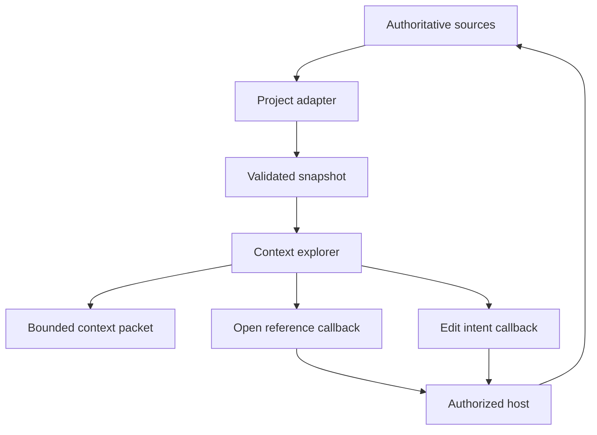

# Architecture

Context Atlas separates project facts, their visual presentation, and the system that
can act on them. This allows an ordinary API project and a model-driven application
studio to share an explorer while retaining different capabilities.

## Data flow

The snapshot is a derived read model. The original API contract, model, migration,
document, or work record remains authoritative. Regeneration can update the graph
without replacing the source's ownership or validation rules.

## Modules

| Module | Owns | Does not own |
| --- | --- | --- |
| Model | Versioned types, validation, IDs, references, graph selection, export | React, filesystem access, source writes |
| OpenAPI adapter | Declared API operations and schemas | Remote reference fetching, runtime discovery, business intent |
| Viewer | Navigation, canvas, inspector, filters, context actions | Authorization, task mutation, compilation, API execution |
| Demo | Synthetic projects, local browser import, presentation shell | Production project context or integration credentials |
| Host integration | Authorized snapshot loading, references, edit validation | Reinterpretation of imported facts as executable logic |

Dependencies point from adapters and the viewer toward the model. The model remains
framework-neutral. Host-specific adapters belong with their hosts when they need
privileged file access, compiler APIs, or workspace permissions.

## Snapshot 1.0

A snapshot contains a project, sources, nodes, edges, and named views. Project capabilities
describe available views. A view selects the objects relevant to a question; it does not
duplicate them. Stable IDs connect a node to its relationships, views, and source evidence.

Nodes describe modules, actors, journeys, pages, operations, services, entities, tables,
work items, documents, decisions, tests, and topics. Edges state a relationship such as
`calls`, `reads`, `writes`, or `tests`; the relation is explicit rather than implied by
position or arrow color.

Source references include a relative path, revision, label, and freshness. A host can
resolve them within an authorized repository. The standalone viewer does not open
arbitrary filesystem paths.

Runtime validation checks structure and references before a snapshot is accepted.
Unknown schema versions fail explicitly. Imported text is rendered as text; a snapshot
does not contain executable callbacks or raw UI markup.

## Evidence is not progress

Three independent dimensions prevent a diagram from overstating what is known:

- **Implementation:** proposed, implemented, verified, or accepted.
- **Evidence:** declared, inferred, or reviewed.
- **Freshness:** current, stale, or unknown at a source revision.

An operation declared by OpenAPI can be proposed and declared. A test may support a
verified implementation while leaving business acceptance unproven. A learning scenario
can explain a feature without becoming its approved contract.

An adapter should expose unsupported relationships as missing information. It cannot
derive service calls or table access from OpenAPI alone. Human-curated documentation
overlays can add reviewed relationships while preserving their own source references.

## Views and journeys

The same object can participate in several views. A data view may focus on a table
while a journey view connects an actor, endpoint, service, table, and failure response.
This is a graph with selected projections, not a single mandatory hierarchy.

Journey steps describe order and meaning for readers. They do not provide workflow
execution semantics. Guards, transactions, permissions, and side effects remain with
the application or model engine that owns them.

Canvas coordinates and viewport state are presentation data. They must not redefine
an operation's identity, a workflow transition, or the meaning of a relationship.

## Context export

Export selects a bounded neighborhood and applies the host's explicit source allowlist.
The resulting Markdown and snapshot describe the selected scope with its evidence.
They should help a reader or coding agent answer what to inspect and what remains unknown.

The host must authorize the snapshot before display and determine which sources may
be exported. An allowlist inside an already loaded graph does not establish a trust
boundary: a viewer process can inspect any data supplied to it.

## Editing and integration

`openReference` asks the host to navigate to a source. `requestEdit` asks it to begin an
edit. Neither callback changes source semantics inside the generic viewer.

A documentation host can open a document editor. A model studio can open an existing
page, field, action, or transition editor, apply its own validation, check an expected
revision, and regenerate derived artifacts. The initial release exposes callbacks;
the production host adapters and model editing remain separate integration work.

See [ADR-0001](adr/0001-derived-context-and-host-owned-edits.md) and
[integration guidance](integration.md).
